  

  
  

  
  
  

## 👨‍💻 About me

  

- 🎧 **Project Solution Specialist at Wolkvox**: I implement contact-center solutions for clients and build internal tooling around them.
- 🤖 **Automation & AI agents**: n8n workflows, WhatsApp bots and multi-agent systems.
- 🧑‍💻 **Freelance full-stack development**: landing pages, dashboards and integrations for small businesses.
- 🏋️ **Code and training**: I build software and I lift. Discipline in one carries over to the other.
- 🎓 Studying Software Engineering at Politécnico Grancolombiano.

## 🚀 Featured projects

  

  
  

  
  

## 🛠️ Tech stack

  

## 🔭 Right now

- Building and improving **Encore**.
- Preparing the **GitHub Foundations** certification.
- Sharing the process of building projects on my YouTube channel, **Core Tech**, and on Instagram.

## 🤝 Let's connect

Open to interesting projects and collaborations. You can find me on Instagram and on my YouTube channel, Core Tech.

